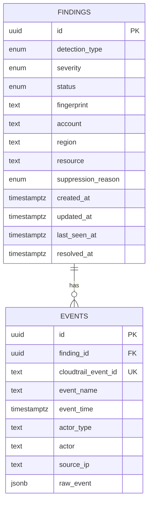
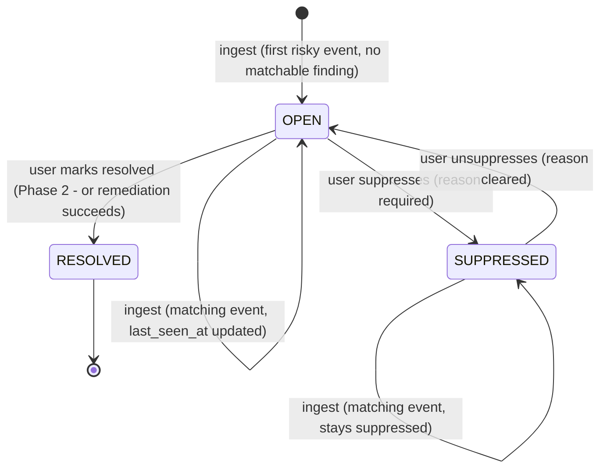

# Data Model

---

## ER Diagram

---

## Entities

### Finding
**What one row represents**: one problem, as defined by its fingerprint.
**What creates it**: ingest, when a risky event arrives with no matchable finding for its fingerprint. The finding and its first event are inserted in one transaction.
**When it changes**: `last_seen_at` when a new event matches, set to the later of its current value and the event’s `eventTime` (CloudTrail time, not ingest time); `status` (with `updated_at` and `resolved_at`) through lifecycle transitions; `severity` can rise when a matching event is more severe; remediation results arrive in Phase 2.
**What `resource` holds**: the normalized ARN of the affected resource. For AdminAccess this is the principal ARN, since the principal is what remediation acts on.
**What `account` and `region` hold**: copies of values in the `resource` ARN, kept as columns for filtering. `region` is NULL for IAM findings, since IAM resources are global.

### Event
**What one row represents**: one occurrence, a single CloudTrail record linked to the finding it caused.
**What creates it**: ingest, for every risky event that passes the duplicate check.
**When it changes**: never. Events are an immutable record.
**Benign events**: only events that produce or match a finding are stored; benign events are dropped. CloudTrail is the system of record for all API activity. As a result, `finding_id` is NOT NULL.
**Who acted (`actor_type`, `actor`)**: `actor_type` is CloudTrail's `userIdentity.type` (`IAMUser`, `AssumedRole`, `Root`, `AWSService`, ...). `actor` is `userIdentity.arn`, or `userIdentity.invokedBy` for `AWSService` calls, which have no ARN; read it together with `actor_type`. `actor_type` is text rather than an enum because AWS adds identity types, and an enum would reject real events. It also makes root activity, a high-signal event, a simple filter.
**Why `source_ip` is text**: CloudTrail sends a service name (e.g. `AWS Internal`) instead of an IP for some calls, which an `INET` column would reject. Switch to `INET` if IP-range queries are needed; the original value is always in `raw_event`.

---

## Enumerations

| Enum | Values | Notes |
|---|---|---|
| `detection_type` | `CLOUDTRAIL_LOGGING_STOPPED`, `ADMIN_ACCESS_GRANTED`, `SG_OPEN_TO_WORLD` | One value per detection rule; also the fingerprint prefix. |
| `severity` | `LOW`, `MEDIUM`, `HIGH`, `CRITICAL` | `CLOUDTRAIL_LOGGING_STOPPED` = HIGH. `ADMIN_ACCESS_GRANTED` = CRITICAL. `SG_OPEN_TO_WORLD` depends on the worst world-open rule: all traffic (`-1`) = CRITICAL; a range including 22 or 3389 = HIGH; any other port = MEDIUM. Severity only rises: a matching event sets it to the higher of the two. `LOW` is reserved for future detections. |
| `status` | `OPEN`, `RESOLVED`, `SUPPRESSED` | `OPEN` and `SUPPRESSED` are **matchable**: new events with the same fingerprint attach to them. `RESOLVED` is final. |
| `suppression_reason` | `ACCEPTED_RISK`, `FALSE_POSITIVE`, `INTENDED` | Required when `status` is `SUPPRESSED`, NULL otherwise. |

---

## Finding Lifecycle

| Transition | Trigger | Rule |
|---|---|---|
| → `OPEN` | Ingest | First risky event with no matchable finding for its fingerprint |
| `OPEN` → `RESOLVED` | User (Phase 2: remediation) | Sets `resolved_at` |
| `OPEN` → `SUPPRESSED` | User | `suppression_reason` required |
| `SUPPRESSED` → `OPEN` | User | Clears `suppression_reason` |
| Anything else | — | Rejected by the API (409) |

### Recurrence

- **Matches a `SUPPRESSED` finding:** the event attaches and the finding stays suppressed. Suppression means "known and accepted," so repeats don't re-alert.
- **Matches only a `RESOLVED` finding:** a **new** `OPEN` finding is created. The resolved finding stays as a closed historical record, which keeps time-to-resolve accurate; the problem coming back is treated as a new incident.

Transition details (who, when, notes) are recorded by the status-history table in Phase 2.

---

## Deduplication and Fingerprinting

### Normalization

Every identifier in a fingerprint is converted to its full ARN, so the same resource
always produces the same fingerprint.

| Component | Source field | Rule |
|---|---|---|
| Trail ARN | `requestParameters.name` | Already an ARN → keep it. Bare name → `arn:aws:cloudtrail:{awsRegion}:{recipientAccountId}:trail/{name}` |
| Principal ARN | `requestParameters.roleName` / `userName` / `groupName` | Always built: `arn:aws:iam::{recipientAccountId}:{role\|user\|group}/{name}` |
| Policy ARN | `requestParameters.policyArn` | Always an ARN → keep it |
| Security group ARN | `requestParameters.groupId` | Always built: `arn:aws:ec2:{awsRegion}:{recipientAccountId}:security-group/{groupId}` |

IAM is a global service, so IAM ARNs have no region — the slot between `iam::` is
intentionally empty.

### Detections --> Fingerprints

| Detection | Fingerprint |
|---|---|
| CloudTrail logging stopped | `CLOUDTRAIL_LOGGING_STOPPED\|arn:aws:cloudtrail:us-east-1:111122223333:trail/test-stop-logging-trail` |
| AdministratorAccess attached | `ADMIN_ACCESS_GRANTED\|arn:aws:iam::111122223333:role/test-iam-attach-admin-role\|arn:aws:iam::aws:policy/AdministratorAccess` |
| SG open to the world | `SG_OPEN_TO_WORLD\|arn:aws:ec2:us-east-1:111122223333:security-group/sg-0123456789abcdef0` | 

- **Format:** components joined with `|`, no spaces, stored as plain text (not hashed): short, structured, and readable when debugging.
- **Excluded:** everything under `userIdentity`, plus `eventID`, `eventTime`, `sourceIPAddress`, `userAgent`, and `eventName`. These describe the occurrence, not the problem, and are stored on the EVENT row.
- **Trail**: Includes the trail arn itself to differentiate between different trails.
- **IAM**: One finding per principal and policy, because remediation detaches one policy from one principal.
- **SG**: One finding per security group. This keeps EVENT→FINDING many-to-one; per-rule findings would need a linking table (deferred).

---

## Constraints and Indexes

| Table | Constraint / Index | Purpose |
|---|---|---|
| `findings` | PK `id` | Row identity |
| `findings` | NOT NULL on `detection_type`, `severity`, `status`, `fingerprint`, `account`, `resource`, `created_at`, `updated_at`, `last_seen_at` | Every finding is fully identified |
| `findings` | Partial UNIQUE on `fingerprint` WHERE `status IN ('OPEN', 'SUPPRESSED')` | At most one matchable finding per problem, even under concurrent ingest; also serves the ingest lookup |
| `findings` | CHECK `(status = 'SUPPRESSED') = (suppression_reason IS NOT NULL)` | Reason present exactly when suppressed |
| `findings` | CHECK `(status = 'RESOLVED') = (resolved_at IS NOT NULL)` | `resolved_at` present exactly when resolved |
| `findings` | CHECK `(detection_type = 'ADMIN_ACCESS_GRANTED') = (region IS NULL)` | IAM findings have no region; all others must |
| `events` | PK `id` | Row identity |
| `events` | UNIQUE `cloudtrail_event_id` | Rejects duplicate delivery of the same CloudTrail event |
| `events` | FK `finding_id` → `findings.id`, NOT NULL | Every stored event belongs to a finding |
| `events` | Index on `finding_id` | Loading a finding's events (Postgres does not index foreign keys automatically) |

Indexes for list filtering (status, severity, `last_seen_at`) are added in 1.6, once the queries exist.

---

## Migrations

Schema changes go through Alembic. Run commands from `application/`. Alembic reads `DATABASE_URL` through `findings_platform` settings (see `alembic/env.py`), never from `alembic.ini`. On the host, the URL in `.env` points at `localhost:5432`; the `api` container builds its own URL with host `db`.

| Command | Purpose |
|---|---|
| `uv run alembic revision --autogenerate -m "<message>"` | Write a new migration by comparing the models to the database |
| `uv run alembic upgrade head --sql` | Preview the SQL without touching the database |
| `uv run alembic upgrade head` | Apply all pending migrations |
| `uv run alembic downgrade -1` | Undo the most recent migration |
| `uv run alembic downgrade base` | Undo every migration (local reset only; drops all data) |
| `uv run alembic current` | Show the applied revision |

**Workflow:**

1. Change the models, then autogenerate a migration.
2. Read every line of the generated file. Autogenerate is a first draft. Check:
   - constraint and index names follow the naming convention in `db/base.py` (no `None`)
   - partial indexes keep their `postgresql_where`
   - `downgrade()` reverses `upgrade()` in the opposite order
   - if the migration creates a Postgres enum type, `downgrade()` drops it after the tables that use it. `drop_table` does not drop the type, and autogenerate omits it.
   - renames: autogenerate reads a renamed column as a drop plus an add, which loses data. Rewrite it as `op.alter_column(..., new_column_name=...)`.
3. Preview with `upgrade head --sql`.
4. Apply, then run `downgrade -1` and `upgrade head` again to prove the downgrade works.
5. Commit the migration in the same PR as the model change.

**Rule:** never edit a migration after it has been applied to a shared database (CI, staging, production). Write a new migration instead.

<!-- TODO: rules for changes that aren't backwards compatible (expand/contract), added with the first such change. -->
